# Swak — Refined Business Document Theme for Obsidian

---

## Overview / 概要

**English**

Swak is an executive-level Obsidian theme focused on "Simple is Best" business structural beauty. It delivers disciplined typography and logical visual hierarchy so that strategic proposals, meeting minutes, and knowledge repositories remain distraction-free and instantly comprehensible.

**日本語**

Swakは、「シンプルイズベスト」に徹底してこだわった、ビジネス特化型の構造美を体現するObsidianテーマです。過剰な装飾を排し、端正なタイポグラフィと明確な視覚的階層によって、戦略提案書、議事録、社内ナレッジを直感的かつ瞬時に理解できるドキュメント環境を提供します。

---

## Business Structural Features / ビジネス構造美の特徴

**English**

- **Executive Heading Architecture**: Solid deep navy banners (`#0B3D63`) for H1 chapter shifts, soft-blue filled containers (`#E6EFF7`) for H2 section boundaries, and distinctive rounded square badges (`■`) for H3 action points.
- **High-Contrast Text Emphasis**: Bold statements, italicized parameters, code literals (`inline code`), and strikethroughs are balanced for immediate scanning without visual fatigue.
- **Refined Callouts**: Subtle fills and clear borders distinguish supporting information. Tip uses the Lucide `lightbulb` icon; Danger uses `circle-alert`.
- **Disciplined Business Tables**: Engineered specifically for cost comparisons, matrix evaluations, and project timelines with balanced padding and slate-gray headers.
- **Structured Lists and Quotes**: Bullets and numbers match the body text color. Compact nesting and neutral quote lines keep the spacing balanced around markers and text.
- **Reading and Live Preview Alignment**: Heading spacing, lists, quotes, callouts, and embedded elements stay closely aligned while switching between reading and editing.
- **Light and Dark Support**: Calibrated colors for both appearances.

**日本語**

- **明瞭な見出し体系（H1・H2・H3）**: 重厚なネイビーの帯見出し（H1）、淡青のセクション区分（H2）、角丸スクエアバッジ（H3）により、長文でも論理構造が一目で把握できます。
- **視認性に優れた文字強調**: 太字（**重要決定事項**）、斜体（*パラメータ*）、インラインコード（`DATABASE_URL`）、打ち消し線（~~旧要件~~）が端正に調和し、必要な情報を迷いなく識別できます。
- **洗練されたコールアウト**: 淡い背景と明確な枠線で補足情報を整理。推奨（Tip）はLucideの `lightbulb`、危険（Danger）は `circle-alert` を使用します。
- **実務志向の表組み**: 比較表や進捗表の可読性を極限まで高めたテーブルスタイリング。
- **整然としたリストと引用**: 箇条書きの点・数字を本文色に統一。コンパクトなネストとグレー系の引用線で、記号・線と文字の余白を整えます。
- **閲覧・編集の見え方を統一**: リーディングビューとライブプレビューの見出し、リスト、引用、コールアウト、埋め込み要素の余白を近づけています。
- **ライト/ダーク両対応**: どちらの環境でも一貫した可読性とトーンを維持します。

### Formatting Examples / 記法例

| Appearance / 表示 | Markdown |
| :--- | :--- |
| Bold / 太字 | `**text**` |
| Red bold / 赤太字 | `***text***` |
| Highlight / ハイライト | `==text==` |
| Red bold with highlight / 赤太字＋ハイライト | `==***text***==` |

For red bold with highlighting, place `***` inside `==`. Use `[!tip]` for recommendations and `[!danger]` for risks or prohibited actions.

赤太字＋ハイライトは、`==` の内側に `***` を置きます。推奨事項は `[!tip]`、危険・禁止事項は `[!danger]` を使用します。

### Callout Colors / コールアウトの配色

| Color / 色 | Purpose / 用途 | Types / 種類 |
| :--- | :--- | :--- |
| Blue / 青 | Information and routine work / 情報・通常の作業 | `note`, `abstract`, `info`, `example`, `todo` |
| Green / 緑 | Recommendations and success / 推奨・成功 | `tip`, `success` |
| Yellow / 黄色 | Caution and review / 注意・確認 | `question`, `warning` |
| Red / 赤 | Danger, failure, and bugs / 危険・失敗・不具合 | `danger`, `failure`, `bug` |
| Gray / グレー | Quotations / 引用 | `quote` |

---

## Complete UI Reference / 全装飾の表示例

For Antigravity IDE / VS Code, the local [Swak Markdown extension](./integrations/vscode/README.md) adds an editable live preview and styles the built-in Markdown preview.

Antigravity IDE / VS Codeでは、ローカルの[Swak Markdown拡張](./integrations/vscode/README.md)で、直接編集できるライブプレビューと標準プレビューの両方にSwakの装飾を適用できます。

Seven bilingual reference sheets show the theme in Light and Dark appearances. [Open the complete sample Markdown](./ui-reference.md).

装飾を7分類に分け、ライト・ダーク両方の実画面を英日併記で掲載しています。[全装飾のサンプルMarkdown](./ui-reference.md)。

### 1. Typography / 文字装飾

H1–H6, bold, italic, red bold, highlights, strikethroughs, links, footnotes, and horizontal rules. / H1–H6、太字、斜体、赤太字、ハイライト、打ち消し線、リンク、脚注、水平線。

#### Light / ライト

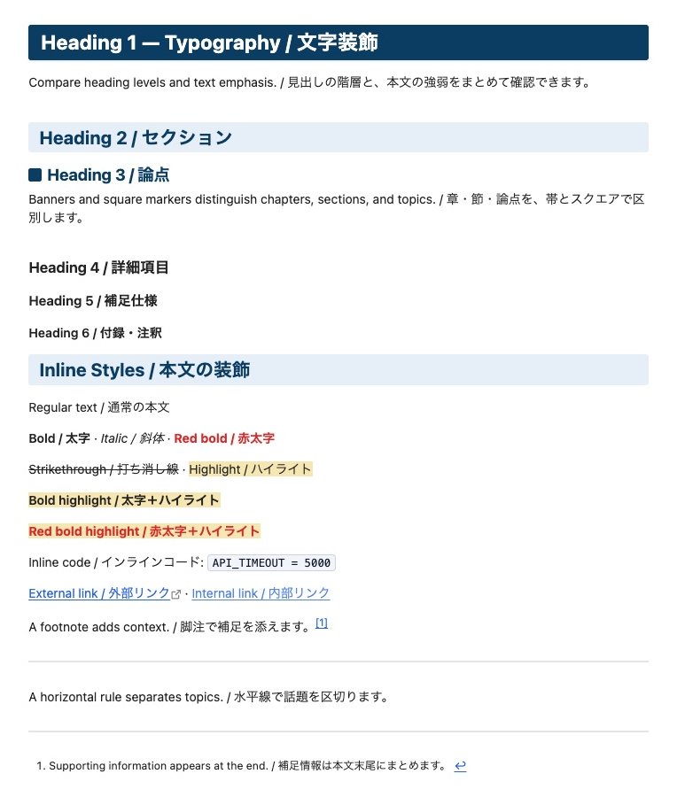

#### Dark / ダーク

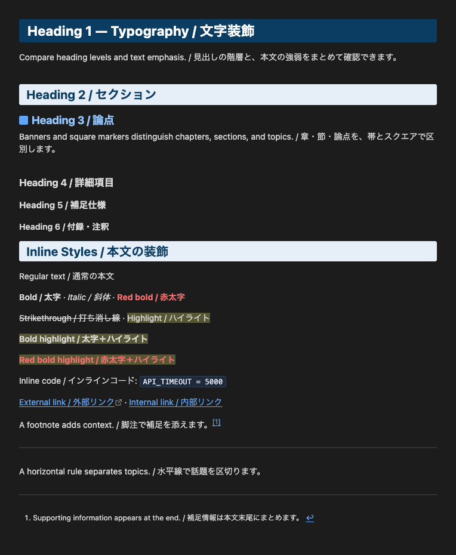

### 2. Structure / 表・リスト・引用

Left-, center-, and right-aligned tables, bullets, numbered lists, checkboxes, and three-level quotes. / 表の左・中央・右揃え、箇条書き、番号リスト、チェックボックス、3階層の引用。

#### Light / ライト

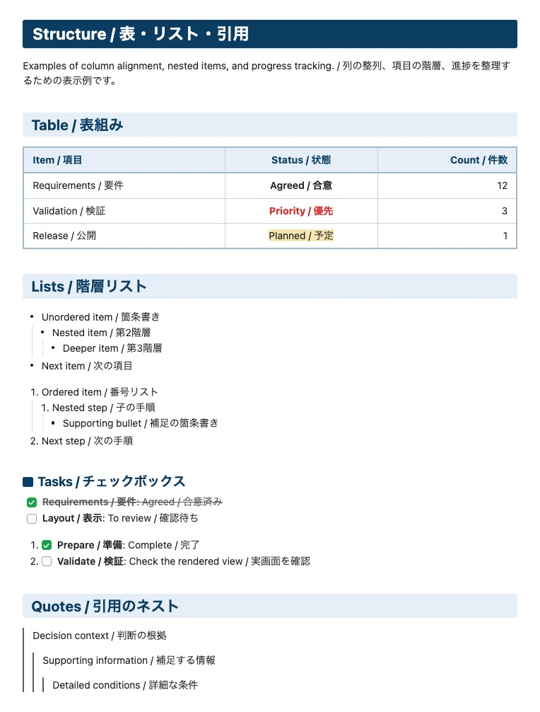

#### Dark / ダーク

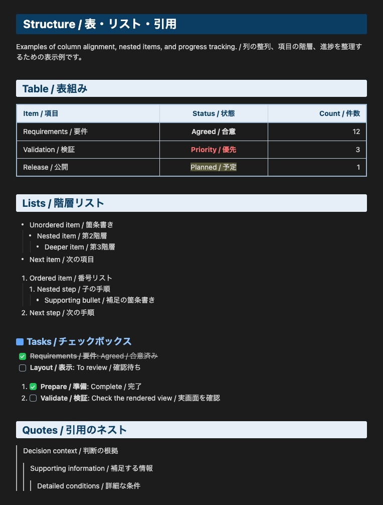

### 3. Callouts 1 / 情報・要約・推奨

Types / 種類: `note`, `abstract`, `info`, `example`, `todo`, `tip`, `success`.

#### Light / ライト

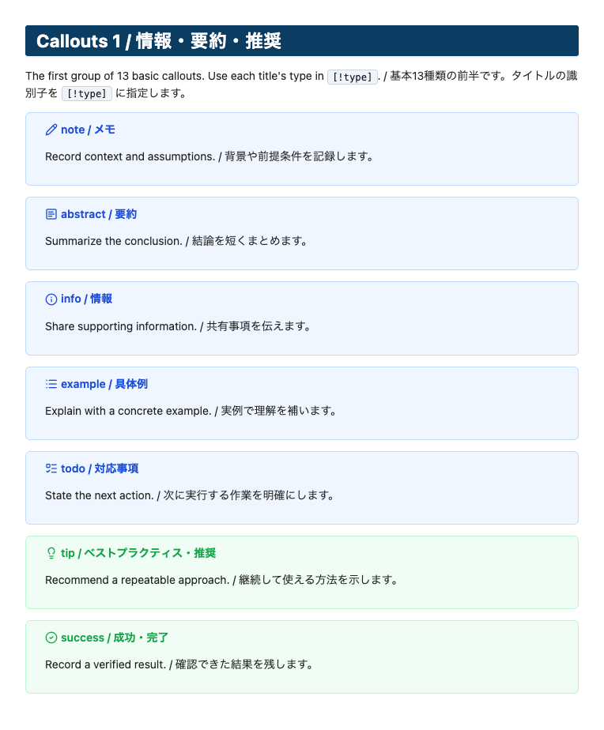

#### Dark / ダーク

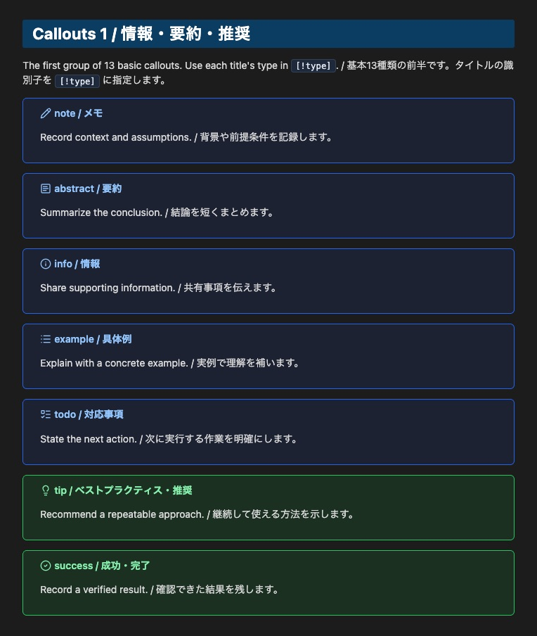

### 4. Callouts 2 / 注意・危険・参照

Types / 種類: `question`, `warning`, `failure`, `danger`, `bug`, `quote`.

#### Light / ライト

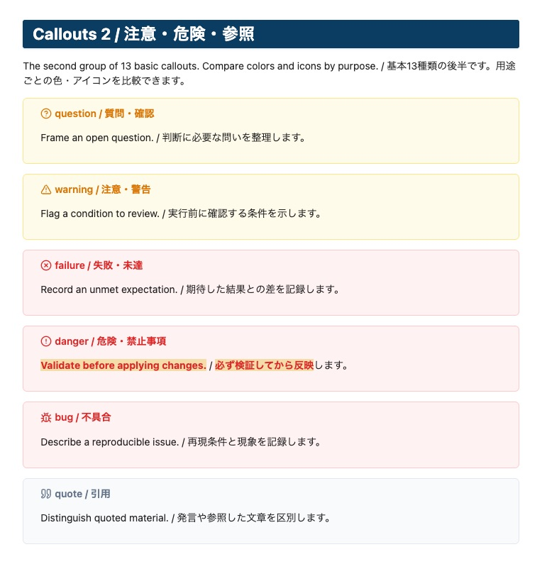

#### Dark / ダーク

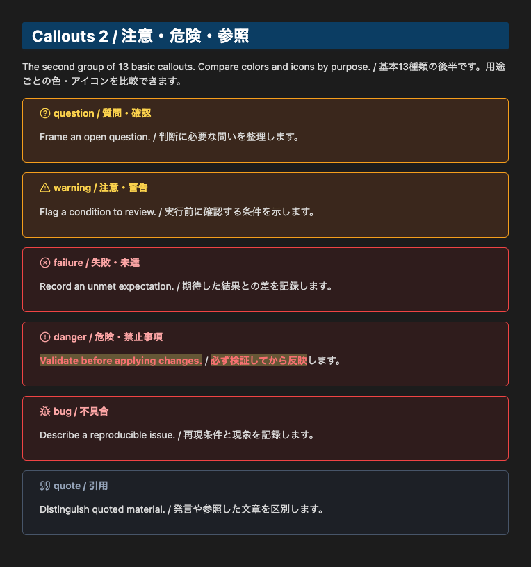

### 5. Callout Layout / 折りたたみ・ネスト

Title-only, initially expanded or collapsed, and three-level nested callouts, plus callouts with tasks. / 本文なし、初期展開・折りたたみ、3階層のネスト、コールアウト内のタスク。

#### Light / ライト

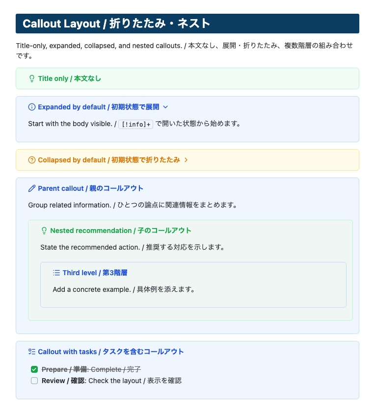

#### Dark / ダーク

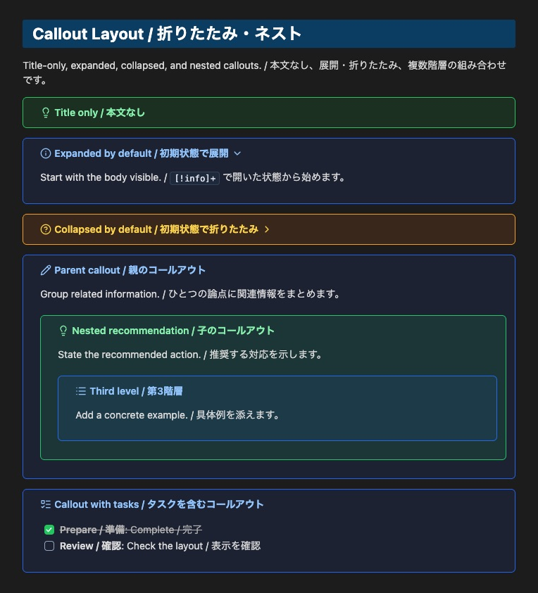

### 6. Code & Diagrams / コード・図・数式

JavaScript, Mermaid flowcharts, inline math, and block math. / JavaScript、Mermaidフロー図、インライン数式、ブロック数式。

#### Light / ライト

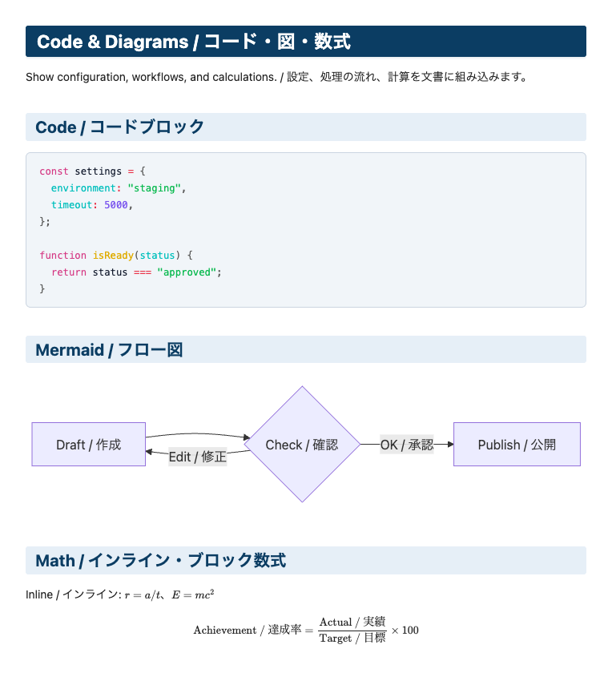

#### Dark / ダーク

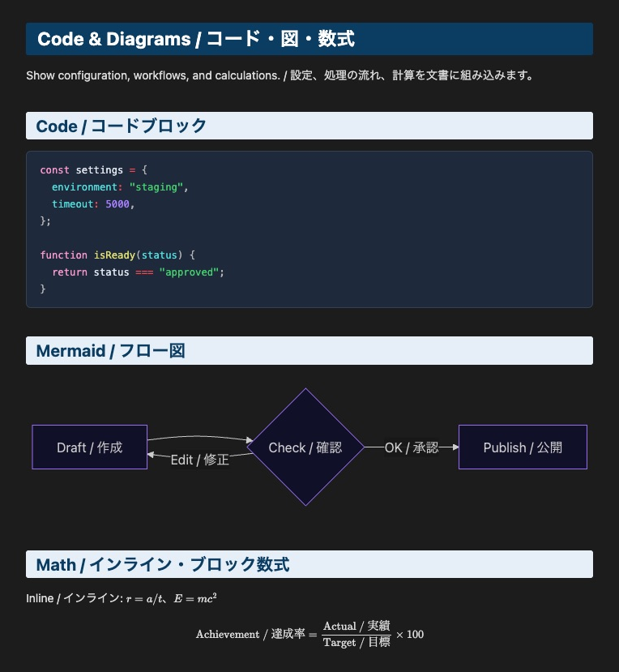

### 7. Details & Embeds / 折りたたみ・埋め込み

Collapsed and expanded HTML details, images, and an [embedded note sample](./ui-embed-sample.md). / HTML detailsの開閉、画像、[ノートの埋め込みサンプル](./ui-embed-sample.md)。

#### Light / ライト

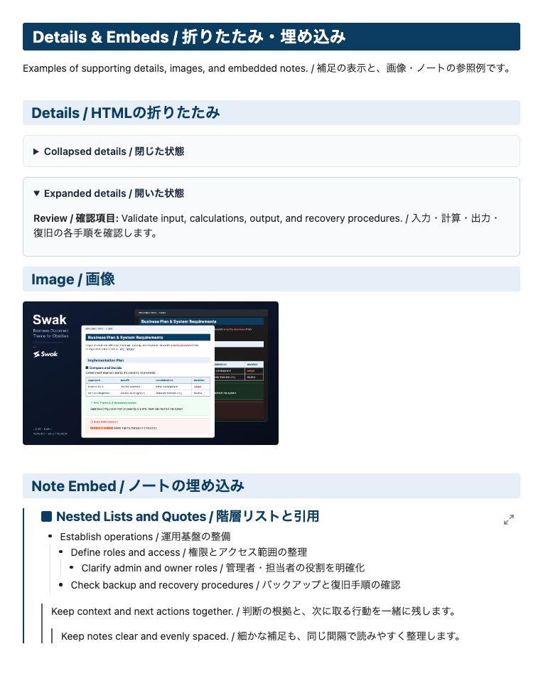

#### Dark / ダーク

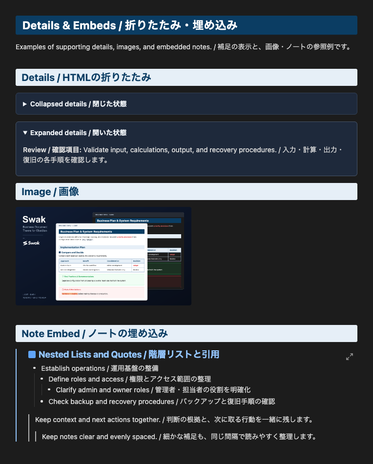

---

## Business Document Samples / 業務文書の表示例

### 1. English UI Showcase / 英語UIサンプル集

**English**: An implementation plan with a comparison table, recommendation and danger callouts, task lists, and nested lists and quotes. [Open the English sample](./ui-sample-en.md).

**日本語**: 導入計画の英語サンプルです。比較表、推奨・危険のコールアウト、タスクリスト、階層リスト、引用ネストを確認できます。[英語サンプルのMarkdown](./ui-sample-en.md)。

#### Light Mode / ライトモード

#### Dark Mode / ダークモード

---

### 2. Japanese UI Showcase / 日本語UIサンプル集

**English**: The same document structure in Japanese, including red bold highlighting and compact nesting. [Open the Japanese sample](./ui-sample-ja.md).

**日本語**: 同じ構成の日本語サンプルです。赤太字＋ハイライト、リストと引用のネストも確認できます。[日本語サンプルのMarkdown](./ui-sample-ja.md)。

#### Light Mode / ライトモード

#### Dark Mode / ダークモード

### 3. Live Preview / ライブプレビュー

**English**: The Japanese sample in Live Preview. Spacing is aligned with Reading view; Markdown markers on the active line and some editor-specific elements can still look different.

**日本語**: 日本語サンプルをライブプレビューで表示した例です。閲覧時に近い余白で編集できます。カーソル行のMarkdown記号や、一部のエディター固有要素には表示差が残ります。

Screenshots captured in Obsidian 1.14.5 at 14px body text, using the sample notes and UI reference above.

上記の業務文書・UIリファレンスをObsidian 1.14.5・本文14pxで表示し、実画面を撮影しています。

---

## Installation / インストール方法

### Option 1: Community Themes (Recommended) / コミュニティテーマから（推奨）

**English**

Swak is available in the [Obsidian Community directory](https://community.obsidian.md/themes/swak). Select **Add to Obsidian** on the listing page, or install it from within Obsidian:

1. Open **Settings** in Obsidian (`Cmd + ,` or `Ctrl + ,`).
2. Navigate to **Appearance** -> **Themes** -> **Community themes**.
3. Click **Manage**, search for **Swak**, and click **Use**.

**日本語**

[Obsidian Communityに掲載されています](https://community.obsidian.md/themes/swak)。掲載ページの **Add to Obsidian**、または次の手順でObsidian内から導入できます。

1. Obsidianの「設定」を開きます（`Cmd + ,` または `Ctrl + ,`）。
2. 「外観」 -> 「テーマ」 -> 「コミュニティテーマ」へ進みます。
3. 「管理」をクリックし、**Swak** で検索して「使用」をクリックします。

### Option 2: Manual Installation / 手動インストール

**English**

1. Download `theme.css` and `manifest.json` from the [Latest Release](https://github.com/swak-inc/obsidian-theme-swak/releases/latest).
2. Create a folder named `Swak` under `<Your Vault>/.obsidian/themes/`.
3. Place `theme.css` and `manifest.json` inside `<Your Vault>/.obsidian/themes/Swak/`.
4. In Obsidian, go to **Settings** -> **Appearance** -> **Theme**, and select **Swak**.

**日本語**

1. [最新リリース](https://github.com/swak-inc/obsidian-theme-swak/releases/latest) から `theme.css` と `manifest.json` をダウンロードします。
2. 保管庫の `.obsidian/themes/` 配下に `Swak` フォルダを作成します。
3. `Swak` フォルダ内にダウンロードした2つのファイルを配置します。
4. Obsidianの「設定」 -> 「外観」 -> 「テーマ」から **Swak** を選択します。

---

## About Swak Inc. / 株式会社Swak

**Swak Inc.**

- Web: [https://swak.jp](https://swak.jp)
- Business: E-commerce Operations / Digital Marketing / Software Development / AI Solutions / Consulting

**株式会社Swak**

- Web: [https://swak.jp](https://swak.jp)
- 事業内容: EC運営 / Webマーケティング / システム開発 / AIソリューション / 各種コンサルティング

---

## License / ライセンス

Licensed under the [MIT License](./LICENSE).

MITライセンスに基づき配布されています。

The embedded `square-text` icon is from [Lucide](https://lucide.dev/icons/square-text) under the ISC License; its notice is included in `theme.css`.

埋め込みの `square-text` アイコンはLucideのISCライセンスに基づき使用し、ライセンス表記を `theme.css` に含めています。
